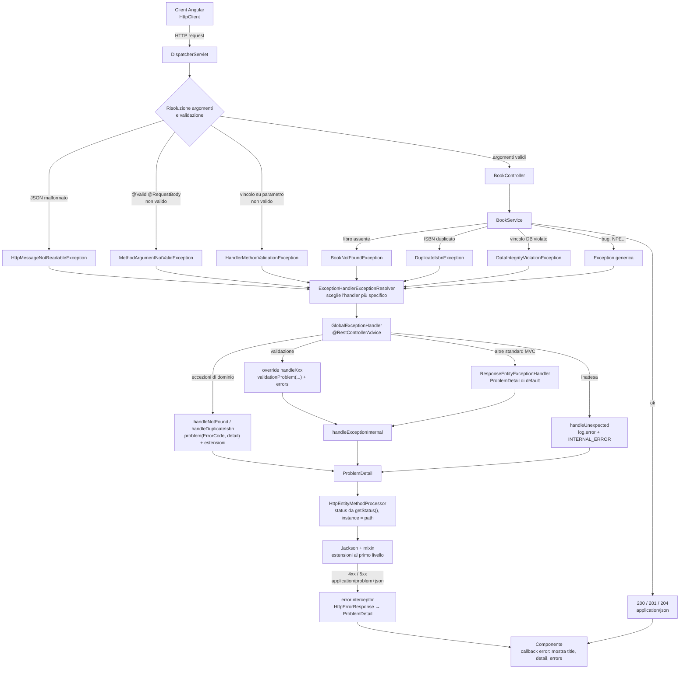
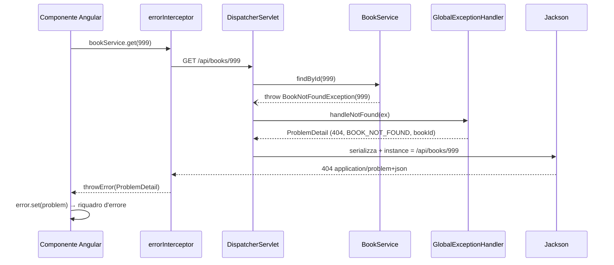

# Manuale operativo: gestione delle eccezioni lato controller

Riferimento: il progetto `basic` (Spring Boot 4.1, Spring Framework 7.0, Hibernate
Validator 9.1). Ogni frammento di codice è tratto da
`backend/src/main/java/it/javalearning/basic/`; le risposte JSON sono state catturate
dal backend in esecuzione.

## Indice

1. [Gli oggetti in gioco](#1-gli-oggetti-in-gioco)
2. [Checked e unchecked](#2-checked-e-unchecked)
3. [Passo 1 – Le eccezioni di dominio](#3-passo-1--le-eccezioni-di-dominio)
4. [Passo 2 – Lanciarle dal service](#4-passo-2--lanciarle-dal-service)
5. [Passo 3 – Il catalogo `ErrorCode`](#5-passo-3--il-catalogo-errorcode)
6. [Passo 4 – Il `ProblemDetail`](#6-passo-4--il-problemdetail)
7. [Passo 5 – Il `GlobalExceptionHandler`](#7-passo-5--il-globalexceptionhandler)
8. [La validazione](#8-la-validazione)
9. [Logging](#9-logging)
10. [Cosa vede il client](#10-cosa-vede-il-client)
11. [Checklist: aggiungere un nuovo errore](#11-checklist-aggiungere-un-nuovo-errore)
12. [Il flusso operativo](#12-il-flusso-operativo)

---

## 1. Gli oggetti in gioco

| Oggetto | Package | Ruolo |
|---|---|---|
| `BookNotFoundException` | `errore` | eccezione di dominio → 404 |
| `DuplicateIsbnException` | `errore` | regola di dominio violata → 409 |
| `ErrorCode` | `errore` | catalogo: per ogni problema stato HTTP, `type`, `title` |
| `GlobalExceptionHandler` | `errore` | `@RestControllerAdvice`: eccezione → `ProblemDetail` |
| `BookRequest` | `libro` | DTO d'ingresso con i vincoli di Bean Validation |
| `BookController` | `libro` | attiva la validazione (`@Valid`, `@Positive`) |
| `BookService` | `libro` | lancia le eccezioni di dominio |

Principio guida: **il controller non contiene `try/catch`**. Il service lancia, l'advice
traduce, il framework scrive la risposta.

---

## 2. Checked e unchecked

```
Throwable
├── Error                       (OutOfMemoryError...: non si gestisce)
└── Exception                   checked: il compilatore impone catch o throws
    └── RuntimeException        unchecked: nessun obbligo
```

**Checked**: il compilatore obbliga ogni chiamante a dichiararla o a catturarla.

```java
public Book findById(long id) throws BookNotFoundException { ... }   // service
public Book get(long id) throws BookNotFoundException { ... }         // controller: costretto a ripeterlo
```

**Unchecked**: nessun obbligo; l'eccezione risale lo stack fino a chi la sa gestire.

```java
public Book findById(long id) { ... throw new BookNotFoundException(id); }   // nessun throws
```

### Perché in un'applicazione Spring si preferiscono le unchecked

1. **Nessuno dei livelli intermedi può fare qualcosa di utile.** Un libro inesistente
   non si "recupera" nel controller: l'unica reazione è rispondere 404, e la decide
   l'advice. Le checked costringerebbero ogni livello a un `throws` che non aggiunge
   informazione.
2. **Le firme restano stabili.** Aggiungere un nuovo errore al service non obbliga a
   modificare controller, interfacce e test.
3. **Funzionano con le lambda.** `orElseThrow(() -> new BookNotFoundException(id))` e gli
   stream non accettano eccezioni checked senza wrapper.
4. **Il rollback di `@Transactional`**, per default, scatta solo su `RuntimeException` ed
   `Error`. Una checked lanciata da un metodo transazionale fa **commit**, salvo
   `rollbackFor`.
5. **È la scelta di Spring stesso.** `DataAccessException`, `ResponseStatusException` e
   tutte le eccezioni di Spring MVC sono unchecked.

La checked resta sensata quando il chiamante diretto **può e deve** reagire, con
un'alternativa concreta (per esempio un `IOException` su cui ritentare). Nel percorso
richiesta → risposta HTTP questo caso è raro.

---

## 3. Passo 1 – Le eccezioni di dominio

Un'eccezione per ogni situazione che il client deve poter distinguere. Estende
`RuntimeException`, porta con sé **i dati dell'occorrenza**, costruisce il messaggio.

```java
public class BookNotFoundException extends RuntimeException {

	private final long bookId;

	public BookNotFoundException(long bookId) {
		super("Libro " + bookId + " inesistente");   // → getMessage()
		this.bookId = bookId;                        // → estensione "bookId" nel JSON
	}

	public long getBookId() {
		return this.bookId;
	}

}
```

`DuplicateIsbnException` segue lo stesso schema con il campo `isbn`.

Regole:

- **Niente dipendenze da Spring Web**: l'eccezione appartiene al dominio, non sa nulla
  di HTTP. Lo stato 404 lo decide il catalogo, non l'eccezione.
- **Il messaggio è per la persona**, i campi sono per la macchina: il client non deve
  mai estrarre l'id dal testo.
- **`getMessage()` e `getCause()` sono cose diverse**: il primo è la stringa passata a
  `super(...)`, il secondo un'altra eccezione (o `null`). Se traduci un'eccezione
  tecnica, passa la causa: `super(messaggio, cause)`.

---

## 4. Passo 2 – Lanciarle dal service

Il service verifica le regole e lancia; non sa che esiste HTTP.

```java
public Book findById(long id) {
	return this.repository.findById(id).orElseThrow(() -> new BookNotFoundException(id));
}

@Transactional
public Book create(BookRequest request) {
	if (this.repository.existsByIsbn(request.isbn())) {
		throw new DuplicateIsbnException(request.isbn());   // 409 chiaro, prima del database
	}
	return this.repository.save(new Book(request.isbn(), request.title(), request.author()));
}
```

Il controllo applicativo non elimina la corsa fra due richieste concorrenti: il vincolo
`uk_book_isbn` del database resta l'ultima difesa, e la sua
`DataIntegrityViolationException` ha un handler dedicato (§7).

Il controller resta pulito:

```java
@GetMapping("/{id}")
public BookResponse get(@PathVariable long id) {
	return BookResponse.from(this.bookService.findById(id));   // nessun try/catch
}
```

---

## 5. Passo 3 – Il catalogo `ErrorCode`

Un enum lega in **un solo punto** il codice macchina, lo stato HTTP e il titolo.

```java
public enum ErrorCode {

	BOOK_NOT_FOUND(HttpStatus.NOT_FOUND, "Libro inesistente"),
	DUPLICATE_ISBN(HttpStatus.CONFLICT, "ISBN già presente"),
	DATA_CONFLICT(HttpStatus.CONFLICT, "Dati in conflitto"),
	VALIDATION_FAILED(HttpStatus.BAD_REQUEST, "Dati non validi"),
	INTERNAL_ERROR(HttpStatus.INTERNAL_SERVER_ERROR, "Errore interno");

	private static final String TYPE_BASE = "https://java-learning.local/errors/";

    private final HttpStatus status;

	private final String title;

	private final URI type;

	ErrorCode(HttpStatus status, String title) {
		this.status = status;
		this.title = title;
		// BOOK_NOT_FOUND → https://java-learning.local/errors/book-not-found
		this.type = URI.create(TYPE_BASE + name().toLowerCase(Locale.ROOT).replace('_', '-'));
	}
	// getter status(), title(), type()
}
```

Vantaggi: un nuovo errore è **una riga**; il contratto con il client è leggibile in un
colpo d'occhio; `type` e `code` non possono divergere, perché derivano dallo stesso nome.

---

## 6. Passo 4 – Il `ProblemDetail`

`org.springframework.http.ProblemDetail` è l'implementazione in Spring della
**RFC 9457** ("Problem Details for HTTP APIs"): un formato standard per il corpo delle
risposte di errore, con media type `application/problem+json`.

### I campi standard

| Campo | Tipo | A cosa serve | Esempio |
|---|---|---|---|
| `type` | URI | **identifica il tipo di problema**; stabile, non tradotto | `https://java-learning.local/errors/book-not-found` |
| `title` | string | riassunto leggibile **del tipo**; uguale per tutte le occorrenze | `Libro inesistente` |
| `status` | int | lo stato HTTP, ripetuto nel corpo (comodo se il corpo viene inoltrato o loggato) | `404` |
| `detail` | string | spiegazione leggibile **di questa occorrenza** | `Libro 999 inesistente` |
| `instance` | URI | identifica l'occorrenza; Spring vi mette il path della richiesta | `/api/books/999` |

Distinzione chiave: `type` e `title` descrivono la **categoria**, `detail` e `instance`
il **caso specifico**.

### `type`: l'identificatore per la macchina

- È un URI per evitare collisioni fra API diverse; **non deve** essere un indirizzo
  raggiungibile (qui il dominio `.local` lo dichiara apertamente).
- Se assente, la RFC lo considera `about:blank`: "nessuna semantica oltre lo stato
  HTTP". È quello che producono le eccezioni standard di Spring (vedi la risposta 405
  in §10): Spring lo omette dal JSON.
- Non va mai tradotto né modificato: il client ci costruisce sopra la logica.

### `code`: un'estensione nostra, gemella di `type`

La RFC non prevede `code`. Lo aggiungiamo perché per il client un identificatore breve è
più comodo di un URI:

```ts
if (problem.code === 'DUPLICATE_ISBN') { form.controls.isbn.setErrors({ duplicate: true }); }
```

`type` resta per interoperabilità con lo standard (gateway, strumenti generici); `code`
per lo `switch` del client e per la traduzione dei messaggi (`errors.DUPLICATE_ISBN`).
Entrambi nascono dal nome della costante di `ErrorCode`.

### Le estensioni

La RFC consente di aggiungere **qualunque altro membro** al JSON: sono le *extension
members*. In Spring si impostano con `setProperty`:

```java
problem.setProperty("code", "BOOK_NOT_FOUND");
problem.setProperty("bookId", 999);
```

Le estensioni portano i **dati strutturati** dell'occorrenza, quelli su cui il client
decide:

| Estensione | Dove | Uso lato client |
|---|---|---|
| `code` | tutte le risposte del catalogo | `switch` sul tipo di errore, chiave di traduzione |
| `bookId` | 404 | link "torna all'elenco", messaggio personalizzato |
| `isbn` | 409 | evidenziare il campo ISBN |
| `errors` | 400 di validazione | un errore sotto ogni campo del form |

Regola del contratto: **il client decide sulle estensioni, mai interpretando `detail`**.

### Come si costruisce

```java
// forStatusAndDetail: status + detail; type resta about:blank finché non lo imposti
ProblemDetail problem = ProblemDetail.forStatusAndDetail(HttpStatus.NOT_FOUND, "Libro 999 inesistente");
problem.setType(URI.create("https://java-learning.local/errors/book-not-found"));
problem.setTitle("Libro inesistente");
problem.setProperty("code", "BOOK_NOT_FOUND");
problem.setProperty("bookId", 999L);
// instance: non serve, lo aggiunge Spring con il path della richiesta
```

Nel progetto queste righe sono raccolte in due helper dell'advice, così ogni handler si
riduce a due o tre righe:

```java
private static ProblemDetail problem(ErrorCode code, String detail) {
	ProblemDetail problem = ProblemDetail.forStatusAndDetail(code.status(), detail);
	describe(problem, code);
	return problem;
}

private static void describe(ProblemDetail problem, ErrorCode code) {   // vale anche su un ProblemDetail di Spring
	problem.setType(code.type());
	problem.setTitle(code.title());
	problem.setProperty("code", code.name());
}
```

### Come diventa JSON

Le estensioni stanno in una `Map<String, Object> properties`, ma nel JSON compaiono **al
primo livello**: Spring applica a `ProblemDetail` un mixin Jackson con `@JsonAnyGetter`
sulla mappa e `@JsonInclude(NON_EMPTY)` sui campi.

```java
// in memoria                                    // sul filo
type       = https://.../book-not-found          {
title      = Libro inesistente                     "type": "https://.../book-not-found",
status     = 404                                   "title": "Libro inesistente",
detail     = Libro 999 inesistente                 "status": 404,
instance   = null  → /api/books/999 (Spring)       "detail": "Libro 999 inesistente",
properties = {code=BOOK_NOT_FOUND, bookId=999}     "instance": "/api/books/999",
                                                   "code": "BOOK_NOT_FOUND",
                                                   "bookId": 999
                                                 }
```

---

## 7. Passo 5 – Il `GlobalExceptionHandler`

### Lo scheletro

```java
@RestControllerAdvice
public class GlobalExceptionHandler extends ResponseEntityExceptionHandler { ... }
```

- `@RestControllerAdvice` = `@ControllerAdvice` + `@ResponseBody`: i metodi
  `@ExceptionHandler` valgono per **tutti** i controller e il loro valore di ritorno è il
  corpo della risposta.
- `extends ResponseEntityExceptionHandler` fa ereditare la gestione di circa venti
  eccezioni standard di Spring MVC (JSON malformato, 405, 415, parametro mancante,
  validazione...), già tradotte in `ProblemDetail`.

### Gli handler di dominio: restituire il `ProblemDetail`

```java
@ExceptionHandler(BookNotFoundException.class)
ProblemDetail handleNotFound(BookNotFoundException ex) {
	ProblemDetail problem = problem(ErrorCode.BOOK_NOT_FOUND, ex.getMessage());
	problem.setProperty("bookId", ex.getBookId());
	return problem;
}
```

Lo status viene letto da `problem.getStatus()`: non serve `@ResponseStatus`. Se servono
header aggiuntivi, si restituisce `ResponseEntity<ProblemDetail>`:

```java
return ResponseEntity.status(problem.getStatus()).header("Retry-After", "5").body(problem);
```

### La rete di sicurezza per il database

```java
@ExceptionHandler(DataIntegrityViolationException.class)
ProblemDetail handleDataIntegrity(DataIntegrityViolationException ex) {
	return problem(ErrorCode.DATA_CONFLICT, "Dati in conflitto");   // mai il messaggio SQL al client
}
```

### L'ultima istanza: 500 senza dettagli

```java
@ExceptionHandler(Exception.class)
ProblemDetail handleUnexpected(Exception ex) {
	log.error("Errore inatteso", ex);                      // lo stack trace va nel log...
	return problem(ErrorCode.INTERNAL_ERROR, "Errore inatteso");   // ...non al client
}
```

### Quale handler vince

Fra più `@ExceptionHandler` compatibili, Spring sceglie quello con il tipo **più vicino**
nella gerarchia dell'eccezione:

| Eccezione lanciata | Handler scelto |
|---|---|
| `BookNotFoundException` | `handleNotFound` (non `handleUnexpected`) |
| `DataIntegrityViolationException` | `handleDataIntegrity` |
| `MethodArgumentNotValidException` | `handleException` ereditato → override `handleMethodArgumentNotValid` |
| `NullPointerException` | `handleUnexpected` |

Vincolo: un'eccezione già dichiarata dalla classe base **non** può avere un
`@ExceptionHandler` proprio nello stesso advice (avvio fallito con *Ambiguous
@ExceptionHandler method*). Per quelle si fa l'override del metodo `handleXxx`.

### Override dei metodi ereditati e `handleExceptionInternal`

Gli override hanno firma imposta: restituiscono `ResponseEntity<Object>`, quindi non
basta `return problem`. Si chiude delegando a `handleExceptionInternal`:

```java
@Override
protected @Nullable ResponseEntity<Object> handleMethodArgumentNotValid(MethodArgumentNotValidException ex,
		HttpHeaders headers, HttpStatusCode status, WebRequest request) {
	List<Map<String, String>> errors = ex.getBindingResult().getFieldErrors().stream()
			.map(e -> fieldError(e.getField(), e.getDefaultMessage()))
			.toList();
	return handleExceptionInternal(ex, validationProblem(ex.getBody(), errors), headers, status, request);
}
```

`handleExceptionInternal` è il punto di convergenza della classe base:

1. se la risposta è già *committed* restituisce `null` (non si può più scrivere un errore);
2. se il body è `null`, lo ricava dall'eccezione (`ErrorResponse`) e lo localizza con il
   `MessageSource`;
3. per i 500 espone l'eccezione come attributo di richiesta;
4. costruisce il `ResponseEntity`.

Attenzione: gli handler di dominio che restituiscono direttamente un `ProblemDetail`
**non** passano da `handleExceptionInternal`. Una decorazione messa in un suo override
(per esempio un `traceId`) non li raggiungerebbe: le regole comuni stanno negli helper
`problem`/`describe`.

---

## 8. La validazione

### I vincoli sul DTO

```java
public record BookRequest(
		@NotBlank @Pattern(regexp = "\\d{13}") String isbn,
		@NotBlank @Size(max = 200) String title,
		@NotBlank @Size(max = 100) String author) {
}
```

- `@Pattern` e `@Size` considerano **valido `null`**: per questo ognuno è affiancato da
  `@NotBlank`.
- Con `"isbn": ""` falliscono sia `@NotBlank` sia `@Pattern`: **due** errori sullo
  stesso campo.
- I messaggi (`getDefaultMessage()`) sono già tradotti da Hibernate Validator nella
  lingua di `Accept-Language`.

### Tre meccanismi, una sola risposta

| # | Cosa annoti | Chi valida | Eccezione |
|---|---|---|---|
| 1 | solo `@Valid` su `@RequestBody` | l'argument resolver, un parametro alla volta | `MethodArgumentNotValidException` |
| 2 | un vincolo **diretto** su un parametro (`@Positive long id`) | la method validation di Spring MVC, tutto il metodo | `HandlerMethodValidationException` |
| 3 | `@Validated` su un bean (AOP) | un proxy | `ConstraintViolationException` |

Il meccanismo 3 è la validazione AOP dei bean, adatta ai service. Il progetto lo
intercetta (`handleConstraintViolation`) per non trasformarlo in un 500, ma non è
trattato in questo manuale.

#### Meccanismo 1: `@Valid @RequestBody`

```java
@PostMapping
public ResponseEntity<BookResponse> create(@Valid @RequestBody BookRequest request) { ... }
```

```
JSON → Jackson → BookRequest → @Valid → Hibernate Validator → BindingResult con errori
     → MethodArgumentNotValidException   (create non viene eseguito)
```

Se il JSON è sintatticamente rotto si ferma prima: `HttpMessageNotReadableException`,
400 senza `errors`.

#### Meccanismo 2: method validation

```java
@PutMapping("/{id}")
public BookResponse update(@PathVariable @Positive long id, @Valid @RequestBody BookRequest request) { ... }
```

Basta **un** vincolo diretto su un parametro perché la method validation si attivi per
**tutto** il metodo, corpo compreso. Il resolver del `@RequestBody` non valida più:
gli errori di `id` e di `request` arrivano **insieme** in una sola
`HandlerMethodValidationException`, che contiene un risultato per parametro:

- `ParameterErrors` per l'oggetto validato a cascata (`request`): ha `getFieldErrors()`;
- `ParameterValidationResult` per il parametro semplice (`id`): ha `getResolvableErrors()`.

```java
@Override
protected @Nullable ResponseEntity<Object> handleHandlerMethodValidationException(
		HandlerMethodValidationException ex, HttpHeaders headers, HttpStatusCode status, WebRequest request) {
	List<Map<String, String>> errors = new ArrayList<>();
	for (ParameterValidationResult result : ex.getParameterValidationResults()) {
		if (result instanceof ParameterErrors body) {
			body.getFieldErrors().forEach(e -> errors.add(fieldError(e.getField(), e.getDefaultMessage())));
		}
		else {
			String name = String.valueOf(result.getMethodParameter().getParameterName());
			result.getResolvableErrors().forEach(e -> errors.add(fieldError(name, e.getDefaultMessage())));
		}
	}
	return handleExceptionInternal(ex, validationProblem(ex.getBody(), errors), headers, status, request);
}
```

Senza questo override la risposta resterebbe quella standard di Spring: 400 corretto ma
**senza** `code` né `errors`.

#### Il valore di ritorno

Un vincolo violato dal **valore restituito** da un controller produce
`MethodValidationException`: l'input era valido, il difetto è del server. Il progetto lo
tratta come `handleUnexpected`: log e 500 `INTERNAL_ERROR`, senza `errors`.

#### L'helper comune

Tutti i meccanismi convergono qui, quindi il client riceve sempre la stessa forma:

```java
private static ProblemDetail validationProblem(ProblemDetail problem, List<Map<String, String>> errors) {
	describe(problem, ErrorCode.VALIDATION_FAILED);
	problem.setDetail("Uno o più valori non sono validi");
	problem.setProperty("errors", errors);
	return problem;
}
```

---

## 9. Logging

```java
private static final Logger log = LoggerFactory.getLogger(GlobalExceptionHandler.class);   // SLF4J
```

| Situazione | Come |
|---|---|
| errore inatteso (500) | `log.error("Errore inatteso", ex)`: `ex` **ultimo argomento** → stack trace completo con i `Caused by` |
| errore di dominio previsto (404, 409) | `log.debug(...)` sintetico, o nessun log: non è un guasto |
| da evitare | `log.error("..." + ex)`, `log.error(ex.getMessage())`, `log.error(msg, ex.getCause())`: si perde lo stack trace |

Si logga **una volta**, nell'advice: non nel service prima di rilanciare.

---

## 10. Cosa vede il client

### Sul filo

Risposte reali del backend (`Accept-Language: it`):

```http
GET /api/books/999

HTTP/1.1 404
Content-Type: application/problem+json

{
  "detail":"Libro 999 inesistente",
  "instance":"/api/books/999","status":404,
  "title":"Libro inesistente",
  "type":"https://java-learning.local/errors/book-not-found",
  "code":"BOOK_NOT_FOUND",
  "bookId":999
}
```

```http
POST /api/books   {"isbn":"9788804668237","title":"Copia","author":"X"}

HTTP/1.1 409
{
  "detail":"ISBN 9788804668237 già presente",
  "instance":"/api/books",
  "status":409,
  "title":"ISBN già presente",
  "type":"https://java-learning.local/errors/duplicate-isbn",
  "code":"DUPLICATE_ISBN",
  "isbn":"9788804668237"
}
```

```http
POST /api/books   {"isbn":"123","title":"","author":"X"}            (meccanismo 1)

HTTP/1.1 400
{
  "detail":"Uno o più valori non sono validi",
  "instance":"/api/books",
  "status":400,
  "title":"Dati non validi",
  "type":"https://java-learning.local/errors/validation-failed",
  "code":"VALIDATION_FAILED",
  "errors":[
            {"field":"title","message":"non deve essere spazio"},
            {"field":"isbn","message":"deve corrispondere a \"\\d{13}\""}
            ]
}
```

```http
PUT /api/books/-1   {"isbn":"123","title":"T","author":"X"}         (meccanismo 2)

HTTP/1.1 400
{... "code":"VALIDATION_FAILED",
 "errors":[{"field":"id","message":"deve essere superiore a 0"},
           {"field":"isbn","message":"deve corrispondere a \"\\d{13}\""}]}
```

Le eccezioni standard **senza override** escono nel formato di default di Spring: niente
`type` (è `about:blank`, omesso), niente `code`.

```http
PATCH /api/books/1

HTTP/1.1 405
Allow: PUT, DELETE, GET
{
  "detail":"Method 'PATCH' is not supported.",
  "instance":"/api/books/1",
  "status":405,
  "title":"Method Not Allowed"
}
```

Il client deve quindi trattare `code` come **facoltativo** e ripiegare su `status`.

### In Angular

1. `HttpClient` riceve un 4xx/5xx ed emette un **errore** (non `next`) di tipo
   `HttpErrorResponse`: `status` dalla riga di stato, `error` = il corpo **già parsato**
   in oggetto.
2. L'interceptor lo normalizza in un `ProblemDetail` tipizzato:

   ```ts
   export const errorInterceptor: HttpInterceptorFn = (req, next) =>
     next(req).pipe(
       catchError((error: HttpErrorResponse) => {
         const problem: ProblemDetail =
           error.status === 0
             ? { status: 0, title: 'Server non raggiungibile' }      // rete giù: nessun corpo
             : { status: error.status, title: error.statusText, ...error.error };
         return throwError(() => problem);
       }),
     );
   ```

3. Il componente riceve il `ProblemDetail` nella callback `error` e lo mostra:

   ```ts
   this.bookService.get(999).subscribe({
     next: (book) => ...,
     error: (problem: ProblemDetail) => this.error.set(problem),
   });
   ```

   ```html
   @for (fieldError of problem.errors ?? []; track fieldError.field) { ... }
   ```

Cosa usa il client di ciascun campo:

| Campo | Uso |
|---|---|
| `status` | ramo generico (401 → login, 5xx → messaggio di servizio) |
| `code` / `type` | ramo specifico (`DUPLICATE_ISBN` → errore sul campo ISBN) |
| `title` | intestazione del riquadro d'errore |
| `detail` | testo per l'utente, **mai** interpretato |
| `errors` | un messaggio sotto ciascun campo del form |
| `bookId`, `isbn` | dati per azioni contestuali |

Insidia: il tipo `ProblemDetail` lato TypeScript è un'asserzione, non una verifica. Un
proxy che risponde con HTML (502) produce un `error.error` stringa; un client robusto
controlla che il corpo sia davvero un problem prima di fidarsi.

---

## 11. Checklist: aggiungere un nuovo errore

Esempio: impedire la cancellazione di un libro in prestito (409).

1. **Eccezione** in `errore/`, unchecked, con i dati dell'occorrenza:

   ```java
   public class BookOnLoanException extends RuntimeException {
   	private final long bookId;
   	public BookOnLoanException(long bookId) {
   		super("Libro " + bookId + " in prestito");
   		this.bookId = bookId;
   	}
   	public long getBookId() { return this.bookId; }
   }
   ```

2. **Costante** nel catalogo:

   ```java
   BOOK_ON_LOAN(HttpStatus.CONFLICT, "Libro in prestito"),
   ```

3. **Lancio** nel service: `if (book.isOnLoan()) throw new BookOnLoanException(id);`

4. **Handler** nell'advice:

   ```java
   @ExceptionHandler(BookOnLoanException.class)
   ProblemDetail handleOnLoan(BookOnLoanException ex) {
   	ProblemDetail problem = problem(ErrorCode.BOOK_ON_LOAN, ex.getMessage());
   	problem.setProperty("bookId", ex.getBookId());
   	return problem;
   }
   ```

5. **Test** con `MockMvcTester`: stato, `Content-Type`, `code`, estensioni.

   ```java
   assertThat(this.mvc.delete().uri("/api/books/3"))
   	.hasStatus(HttpStatus.CONFLICT)
   	.hasContentType(MediaType.APPLICATION_PROBLEM_JSON)
   	.bodyJson()
   	.hasPathSatisfying("$.code", code -> code.assertThat().isEqualTo("BOOK_ON_LOAN"));
   ```

6. **Client**: aggiungere l'estensione all'interfaccia `ProblemDetail` e, se serve, un
   ramo sul nuovo `code`.

---

## 12. Il flusso operativo

### Dalla richiesta alla risposta



### Chi fa cosa, nel tempo



### Le responsabilità in sintesi

| Livello | Fa | Non fa |
|---|---|---|
| DTO | dichiara i vincoli | non valida da sé |
| Controller | attiva la validazione, delega | nessun `try/catch` |
| Service | verifica le regole, lancia eccezioni di dominio | non conosce HTTP |
| Eccezione di dominio | porta messaggio e dati | non conosce lo stato HTTP |
| `ErrorCode` | lega code, stato, type, title | — |
| Advice | traduce eccezione → `ProblemDetail`, logga l'inatteso | non scrive la risposta |
| Spring MVC | status, header, serializzazione, invio | — |
| Interceptor Angular | normalizza in `ProblemDetail` | non mostra nulla |
| Componente | mostra, decide su `code` ed estensioni | non interpreta `detail` |
